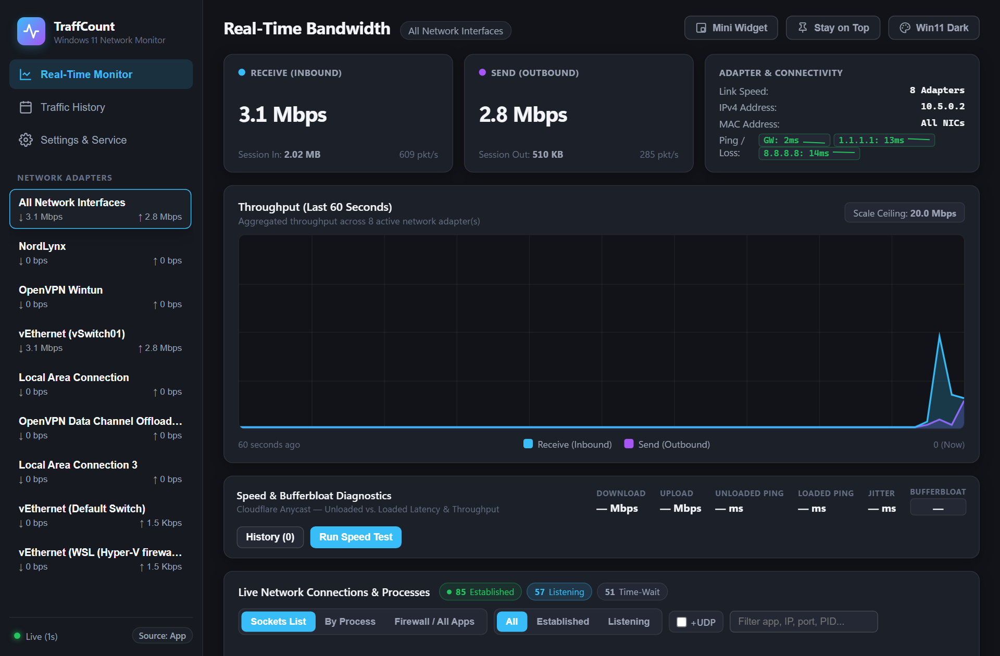
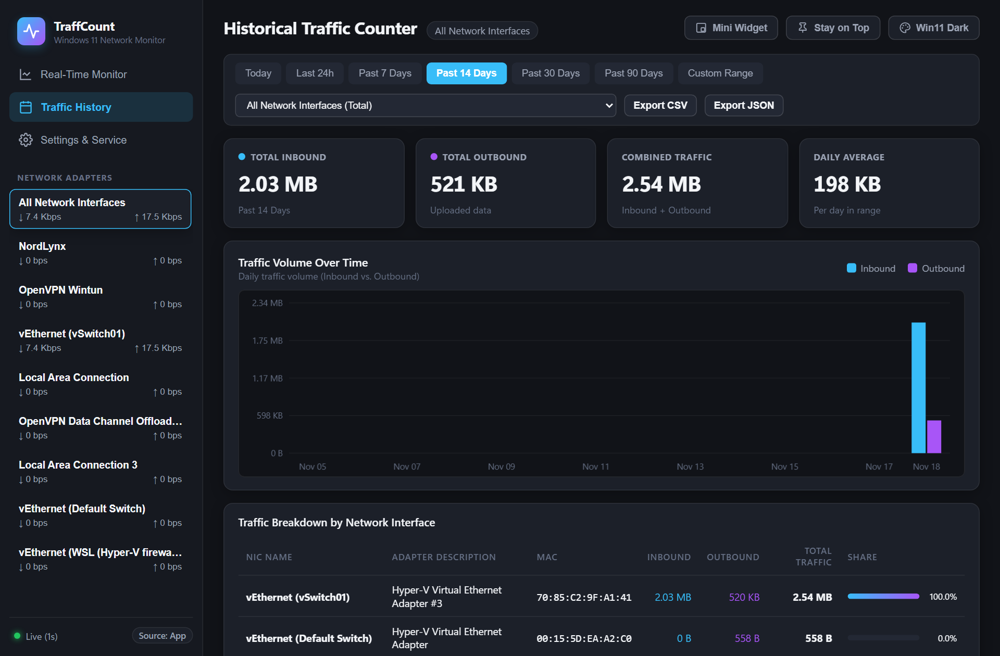
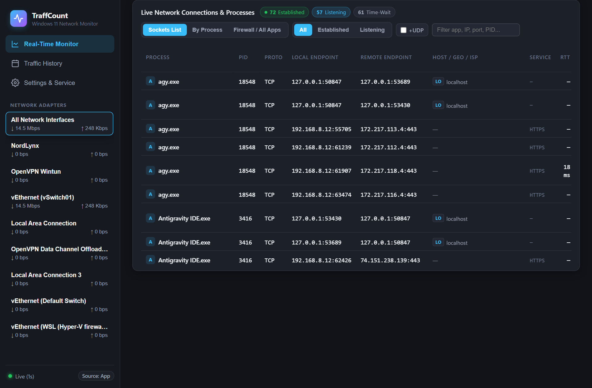
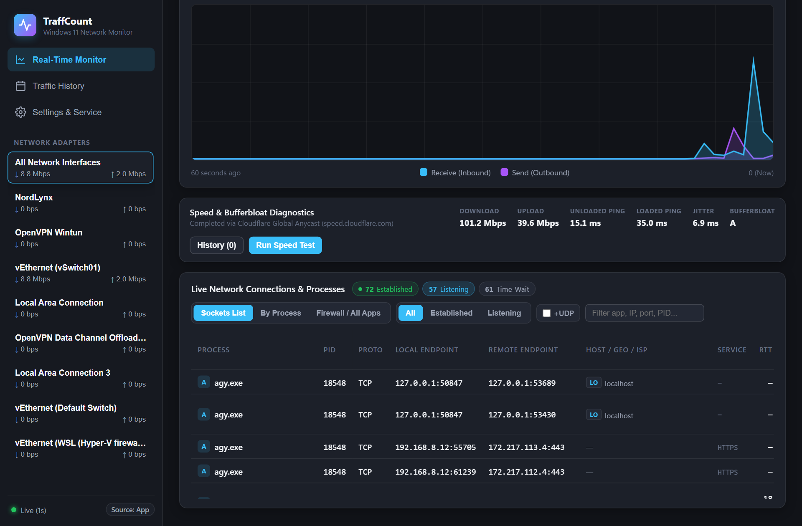
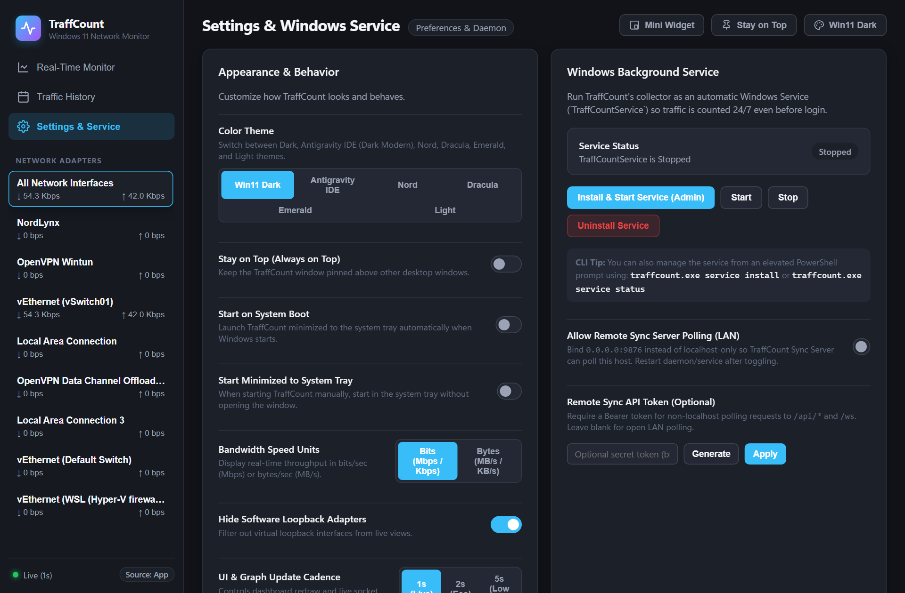
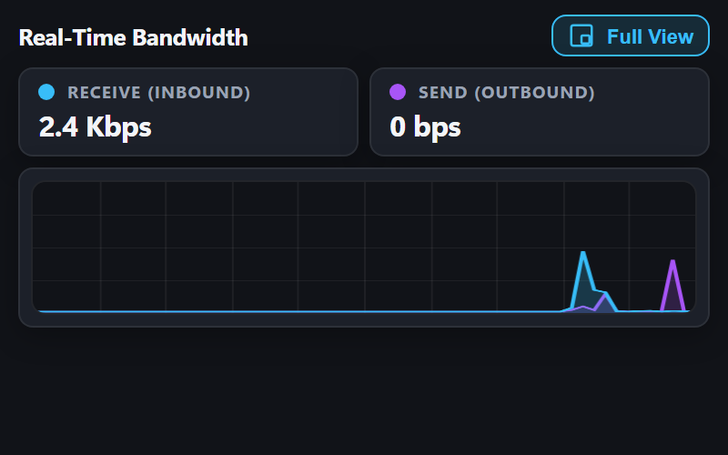

# TraffCount

Real-time network bandwidth monitor and historical traffic counter for **Windows 11** and **Raspberry Pi OS / Linux**, written in Go.

## Screenshots

### 1. Real-Time Bandwidth Monitor
Live per-second upload and download throughput chart, adapter selection, real-time connectivity pings, and daemon data collection status.



### 2. Historical Traffic Counter & Analytics
Long-term historical bandwidth accounting stored in SQLite across reboots, with timeframe filters (Today, 24h, 7d, 14d, 30d, 90d, custom), daily volume bar charts, interface distribution, and CSV/JSON export.



### 3. Live Network Connections & Process Monitor
Active TCP/UDP sockets table displaying process names, PIDs, local and remote endpoints, protocol states (Established, Listening, Time-Wait), Geo/Host lookups, and socket filtering.



### 4. Speed Test & Bufferbloat Diagnostics
Built-in latency, jitter, download/upload throughput benchmark, and Bufferbloat grade evaluation via Cloudflare Global Anycast.



### 5. Settings, Windows Service & Quota Management
Configurable monthly billing-cycle data cap with progress bar, bandwidth spike alerts, color themes (Win11 Dark, Antigravity IDE, Nord, Dracula, Emerald, Light), and Windows Background Service controls.



> **Tip:** TraffCount also includes a compact **Mini Widget** floating overlay mode (`380x230`) that stays pinned on top of your desktop for quick glanceable throughput monitoring:
>
> 

## Features

- **24/7 Background Counting:** Runs as a native Windows Service (`TraffCountService`) in Session 0 so traffic is counted continuously even before user logon or when the app window is closed.
- **Seamless Desktop Fallback:** If the Windows Service is stopped, the desktop tray application seamlessly takes over in-process data collection with zero interruption.
- **Per-Process Traffic Tracking:** Uses Windows `GetPerTcpConnectionEStats` / TCP Extended Statistics to accurately attribute network volume to individual executables.
- **System Tray Integration:** Native Windows 11 tray icon with real-time speed tooltips, quick actions, "Stay on Top", and smooth DWM minimize/restore animations.
- **Standalone App Window:** Frameless standalone Edge `--app` window with dedicated profile isolation, persistent window bounds, and themes.

## Build

```powershell
.\build.ps1
```

## CLI Usage

```powershell
# Start TraffCount (System Tray icon + GUI dashboard window)
.\traffcount.exe

# Start minimized in the System Tray only
.\traffcount.exe --tray-only

# Close a running TraffCount tray instance
.\traffcount.exe quit
```

### Windows Service Commands

```powershell
# Check Windows Service status
.\traffcount.exe service status

# Install and start TraffCountService (prompts for Admin UAC)
.\traffcount.exe service install

# Start or stop an installed service
.\traffcount.exe service start
.\traffcount.exe service stop

# Stop and remove TraffCountService
.\traffcount.exe service uninstall
```

## Raspberry Pi OS / Linux

TraffCount runs on **Raspberry Pi 3B+**, **Raspberry Pi 4**, and newer models (both 64-bit `arm64` and 32-bit `armv7` Raspberry Pi OS) as a pure-Go CLI daemon + standalone HTTP/WebSocket web dashboard (`http://<pi-ip>:9876`).

### Build on Raspberry Pi (or cross-compile on Linux)

`build-pi.sh` checks whether Go is installed and meets the version in `go.mod`, offers to install/upgrade Go automatically into `/usr/local/go`, and compiles a static binary (`CGO_ENABLED=0`):

```bash
chmod +x build-pi.sh

# Auto-detect Raspberry Pi architecture (arm64 or armv7), check/install Go, and build ./traffcount
./build-pi.sh

# Or explicitly target 64-bit / 32-bit / both
./build-pi.sh --arch arm64
./build-pi.sh --arch armv7
./build-pi.sh --arch all

# Unattended build with automatic Go installation
./build-pi.sh --install-go -y
```

### CLI & systemd Service Usage (Raspberry Pi)

```bash
# Run standalone CLI + web server on 0.0.0.0:9876 (accessible from your LAN)
./traffcount

# Or specify a custom listen address / port
./traffcount --addr 0.0.0.0:8080

# Install system-wide and run 24/7 as a systemd background service
sudo install -m 0755 ./traffcount /usr/local/bin/traffcount
sudo traffcount service install

# Manage or inspect the systemd service
traffcount service status
sudo traffcount service start
sudo traffcount service stop
sudo traffcount service restart
sudo traffcount service uninstall

# Stop a running standalone CLI instance gracefully
traffcount quit
```

## TraffCount Sync Server (Multi-Host Central Aggregator)

`traffcount-sync` is a standalone central server + web dashboard that polls multiple Windows 11 and Raspberry Pi TraffCount hosts on your LAN, reconciles hourly SQLite metrics losslessly, and visualizes fleet-wide and per-host traffic (`http://<sync-host>:9880`).

### Build & Run on Windows 11

```powershell
.\build-sync.ps1
.\traffcount-sync.exe                  # Foreground server on http://0.0.0.0:9880
.\traffcount-sync.exe service install  # Install & start Windows Service (TraffCountSyncService)
.\traffcount-sync.exe service status   # Check service state
.\traffcount-sync.exe hosts list       # List registered remote hosts
```

### Polling Windows 11 Agents Remotely

Raspberry Pi agents listen on `0.0.0.0:9876` by default. On Windows 11 agents (`traffcount.exe`), open **Settings & Service**, enable **Allow Remote Sync Server Polling (LAN)** (optionally setting a Bearer **Sync API Token**), and restart `TraffCountService` / the app so port `9876` listens on LAN.

### Capturing Screenshots

To regenerate the documentation screenshots using headless Edge via the Chrome DevTools Protocol:

```powershell
node scripts/capture_all.js
```
