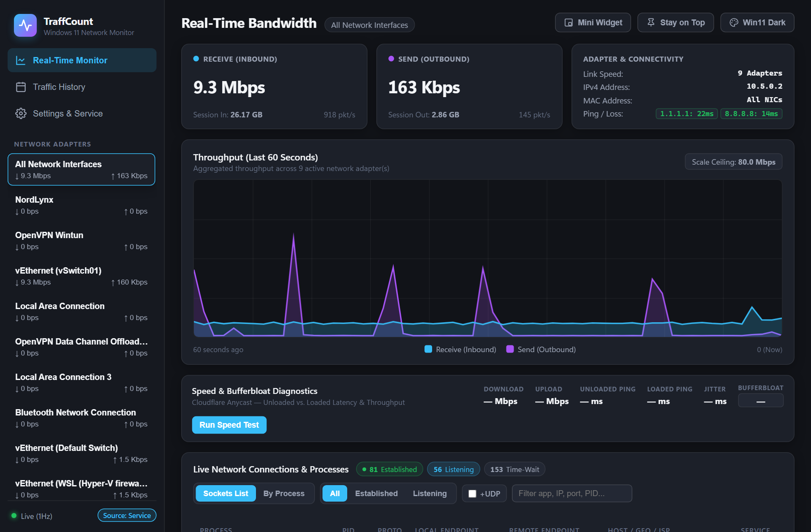
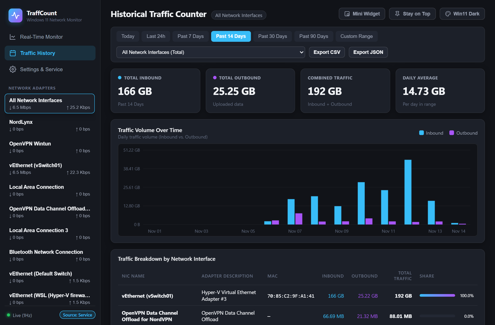
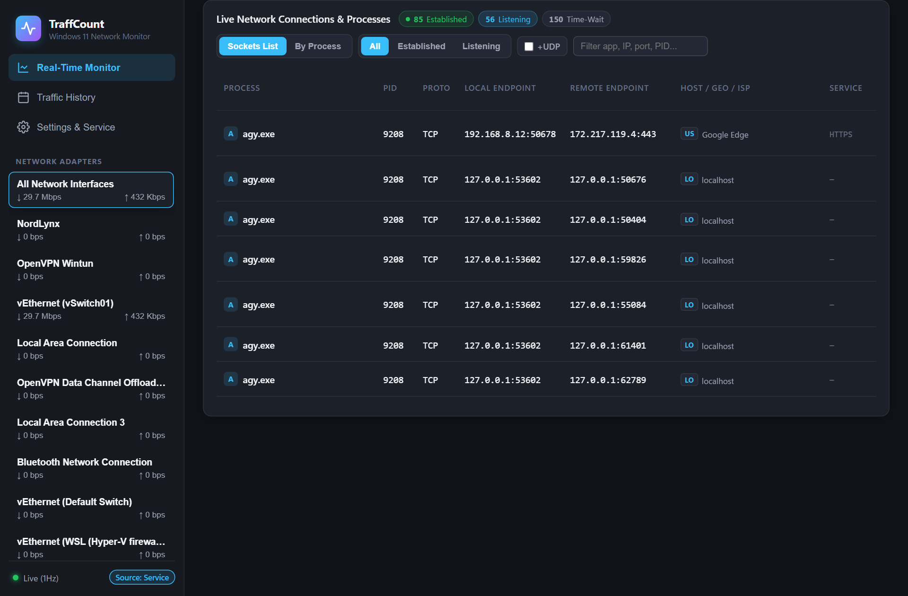
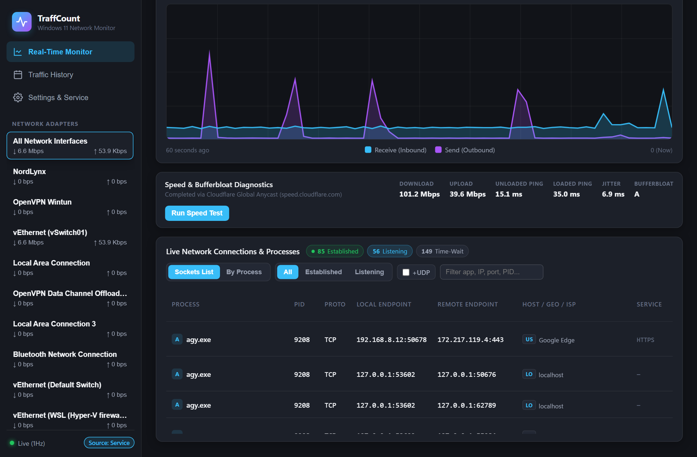
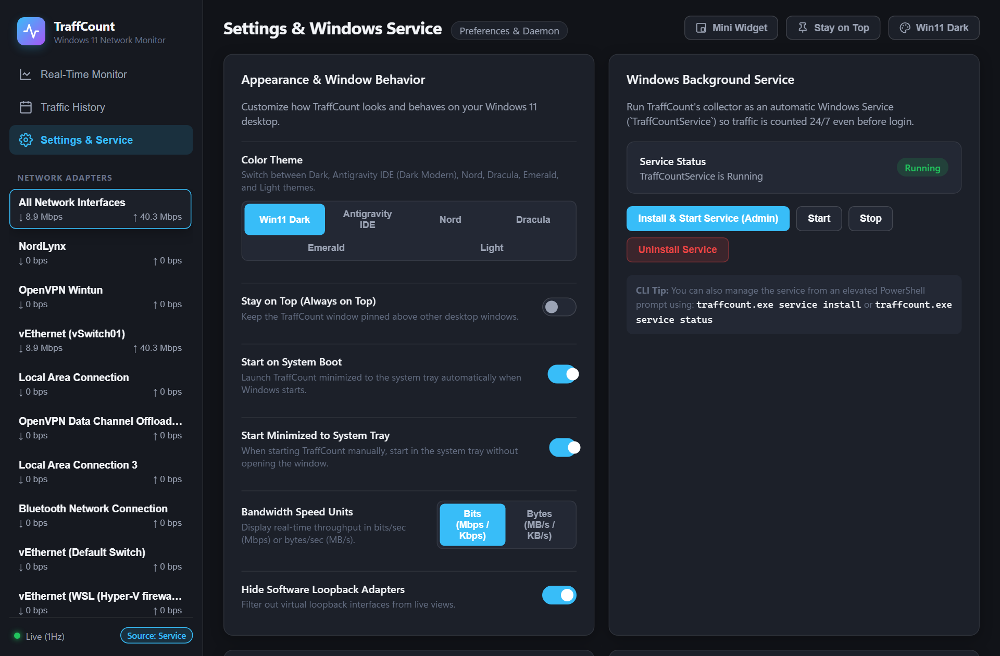
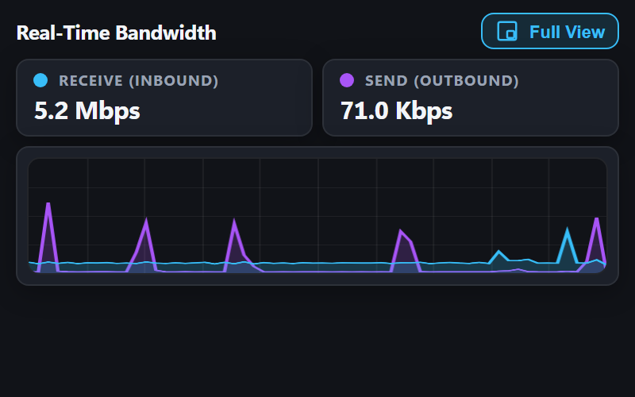

# TraffCount

Real-time network bandwidth monitor and historical traffic counter for Windows 11, written in Go.

## Screenshots

### 1. Real-Time Bandwidth Monitor
Live per-second upload and download throughput chart, adapter selection, real-time connectivity pings, and daemon data collection status.



### 2. Historical Traffic Counter & Analytics
Long-term historical bandwidth accounting stored in SQLite across reboots, with timeframe filters (Today, 24h, 7d, 14d, 30d, 90d, custom), daily volume bar charts, interface distribution, and CSV/JSON export.



### 3. Live Network Connections & Process Monitor
Active TCP/UDP sockets table displaying process names, PIDs, local and remote endpoints, protocol states (Established, Listening, Time-Wait), Geo/Host lookups, and socket filtering.



### 4. Speed Test & Bufferbloat Diagnostics
Built-in latency, jitter, download/upload throughput benchmark, and Bufferbloat grade evaluation via Cloudflare Global Anycast.



### 5. Settings, Windows Service & Quota Management
Configurable monthly billing-cycle data cap with progress bar, bandwidth spike alerts, color themes (Win11 Dark, Antigravity IDE, Nord, Dracula, Emerald, Light), and Windows Background Service controls.



> **Tip:** TraffCount also includes a compact **Mini Widget** floating overlay mode (`380x230`) that stays pinned on top of your desktop for quick glanceable throughput monitoring:
>
> 

## Features

- **24/7 Background Counting:** Runs as a native Windows Service (`TraffCountService`) in Session 0 so traffic is counted continuously even before user logon or when the app window is closed.
- **Seamless Desktop Fallback:** If the Windows Service is stopped, the desktop tray application seamlessly takes over in-process data collection with zero interruption.
- **Per-Process Traffic Tracking:** Uses Windows `GetPerTcpConnectionEStats` / TCP Extended Statistics to accurately attribute network volume to individual executables.
- **System Tray Integration:** Native Windows 11 tray icon with real-time speed tooltips, quick actions, "Stay on Top", and smooth DWM minimize/restore animations.
- **Standalone App Window:** Frameless standalone Edge `--app` window with dedicated profile isolation, persistent window bounds, and themes.

## Build

```powershell
.\build.ps1
```

## CLI Usage

```powershell
# Start TraffCount (System Tray icon + GUI dashboard window)
.\traffcount.exe

# Start minimized in the System Tray only
.\traffcount.exe --tray-only

# Close a running TraffCount tray instance
.\traffcount.exe quit
```

### Windows Service Commands

```powershell
# Check Windows Service status
.\traffcount.exe service status

# Install and start TraffCountService (prompts for Admin UAC)
.\traffcount.exe service install

# Start or stop an installed service
.\traffcount.exe service start
.\traffcount.exe service stop

# Stop and remove TraffCountService
.\traffcount.exe service uninstall
```

### Capturing Screenshots

To regenerate the documentation screenshots using headless Edge via the Chrome DevTools Protocol:

```powershell
node scripts/capture_all.js
```
